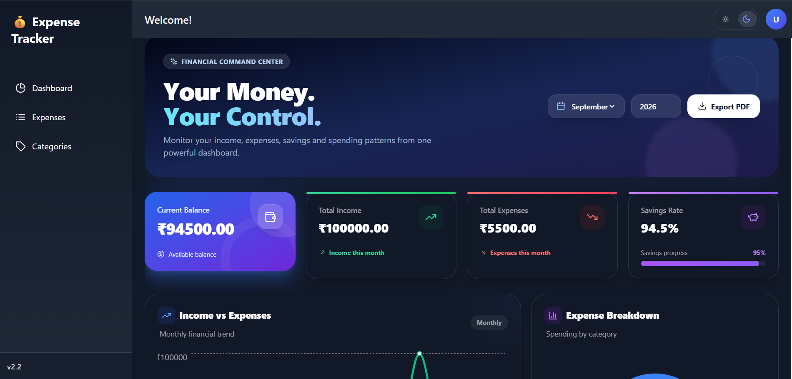
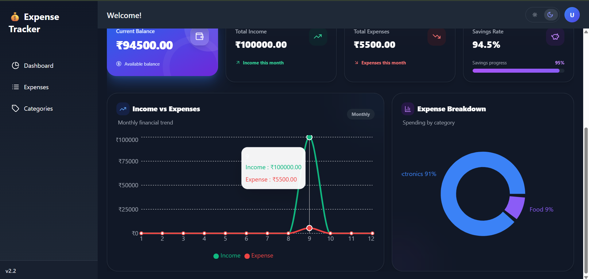

# 💸 Expense-Tracker

<p align="center">
  


</p>

> A modern full-stack personal finance management application built with
> **React**, **FastAPI**, **SQLAlchemy**, and **PostgreSQL/SQLite**.
> Track income and expenses, manage category budgets, visualize
> financial insights, and export reports in PDF and CSV formats through
> A clean dashboard.

------------------------------------------------------------------------

## 🌐 Live Demo

🔗 ___Upcoming Soon___

------------------------------------------------------------------------

## 📸 Screenshots

### Dashboard


### Expenses


### Categories


------------------------------------------------------------------------

## ✨ Features

-   Income & Expense Tracking
-   Dashboard with financial summary cards
-   Interactive analytics using Recharts
-   Category management
-   Monthly budget monitoring
-   Budget alerts
-   PDF report export
-   CSV export
-   Responsive UI
-   Dark / Light theme
-   FastAPI REST API
-   Docker-ready development setup

------------------------------------------------------------------------

## 🛠 Tech Stack

### Frontend

-   React 18
-   Tailwind CSS
-   Recharts
-   React Router
-   Lucide React
-   React Toastify
-   jsPDF
-   html2canvas

### Backend

-   FastAPI
-   SQLAlchemy
-   PostgreSQL / SQLite

### Tools

-   Docker
-   Git
-   GitHub

------------------------------------------------------------------------

## 🚀 Installation

### Prerequisites

-   Node.js 16+
-   Python 3.9+
-   Docker (optional)

### Quick Start

``` powershell
.\start-dev.ps1
```

### Manual Setup

#### Backend

``` bash
cd backend
python -m venv venv
venv\Scripts\activate
pip install -r requirements.txt
python main.py
```

#### Frontend

``` bash
cd frontend
npm install
npm start
```

------------------------------------------------------------------------

## 🏗 Project Structure

``` text
Expense_Tracker/
├── backend/
├── frontend/
├── screenshots/
├── .gitignore/
├── docker-compose.yml
└── LICENSE
├── package-lock.json
├── package.json
├── README.md
├── start-dev.ps1
```

------------------------------------------------------------------------

## 📊 Dashboard & Analytics

-   Current Balance
-   Total Income
-   Total Expenses
-   Savings Overview
-   Income vs Expense Trend
-   Category Breakdown
-   Budget Progress
-   Recent Transactions

------------------------------------------------------------------------

## 📥 Export Features

-   PDF Dashboard Report
-   CSV Transaction Export

------------------------------------------------------------------------

## 📅 Version History

  Version   Highlights
  --------- -----------------------------------------------
  v2.2      Analytics, PDF Export, Dashboard Improvements
  v2.1      Income Tracking, Enhanced Dashboard
  v2.0      UI/UX Modernization, Animations
  v1.0      Initial Expense Tracking

------------------------------------------------------------------------

## 🛣 Future Roadmap

-   User Authentication
-   Cloud Synchronization
-   Enhanced Budget Insights
-   More Financial Reports

------------------------------------------------------------------------

## ⭐ Support the Project

If you found this project useful:

-   ⭐ Star the repository
-   🍴 Fork the repository
-   🐞 Report bugs
-   💡 Suggest improvements

Your support helps improve the project.

------------------------------------------------------------------------

## 📜 License

Licensed under the **MIT License**.

See the `LICENSE` file for details.

------------------------------------------------------------------------

## ❤️ Built By

**Shashwat Sharma**

Computer Science Engineering Student

GitHub: https://github.com/Shashwatss10

If you found this project helpful, consider giving it a ⭐. 
# Smart Expense Tracker

A full-stack web application for managing personal finances, tracking income and expenses, monitoring budgets, and understanding spending patterns through a centralized dashboard.

Built with **React.js, Flask, SQLAlchemy, and PostgreSQL/SQLite**, the application provides an organized way to record transactions, analyze financial activity, and manage everyday expenses.


## 📑 Table of Contents

- [Overview](#-overview)
- [Features](#-features)
- [Application Preview](#-application-preview)
- [Technology Stack](#-technology-stack)
- [Getting Started](#-getting-started)
- [Project Structure](#-project-structure)
- [Planned Improvements](#-planned-improvements)
- [Contributing](#-contributing)

## 🔎 Overview

Smart Expense Tracker helps users organize their financial activity in one place. Instead of manually reviewing individual transactions, users can view summaries, categorize expenses, monitor budgets, and explore spending trends.

The project demonstrates practical full-stack development concepts, including REST API integration, database operations, reusable React components, data visualization, and report generation.

## ✨ Features

- **Transaction Management** — Record and manage income and expense transactions.
- **Financial Dashboard** — View key financial summaries, including income, expenses, and balance.
- **Category Management** — Organize transactions by category.
- **Budget Monitoring** — Track budget usage and review spending against planned limits.
- **Financial Analytics** — Visualize income, expenses, and category-wise spending.
- **Data Export** — Export supported financial data and reports to CSV and PDF formats.
- **Transaction Filtering** — Find transactions using available filters and date ranges.
- **Responsive Interface** — Access the application through a clean, user-friendly web interface.

*Ensure the listed features match the current implementation of the application.*

## 🖥️ Application Preview

Add screenshots of your running application to the `screenshots/` directory.

| Dashboard | Transactions |
|---|---|
|  |  |

| Expense | Categories |
|---|---|
|  |  |

> **Note:** Replace these image paths with your actual screenshot filenames. Remove entries for pages that are not implemented yet.

## 🧰 Technology Stack

| Component | Technologies |
|---|---|
| Frontend | React.js, JavaScript, HTML, CSS |
| Backend | Python, Flask |
| Database and ORM | PostgreSQL or SQLite, SQLAlchemy |
| Charts | Recharts, if used in the current frontend |
| Reports | CSV and PDF export libraries |
| Development Tools | Git, GitHub, npm, Python virtual environments |
| Containerization | Docker, Docker Compose configuration |

## 🚀 Getting Started

Follow these instructions to run the project locally.

### Prerequisites

Install the following tools before starting:

- [Node.js and npm](https://nodejs.org/)
- [Python](https://www.python.org/downloads/)
- [Git](https://git-scm.com/downloads/)
- Docker, if you plan to use the containerized setup

### 1. Clone the Repository

```bash
git clone https://github.com/Shubham09-tech/Smart_Expense_Tracker.git
cd Smart_Expense_Tracker
```

### 2. Set Up the Backend

Open a terminal in the project root and run:

```powershell
cd backend
python -m venv venv
.\venv\Scripts\Activate.ps1
pip install -r requirements.txt
python main.py
```

If PowerShell blocks virtual-environment activation, use Command Prompt and run:

```bat
venv\Scripts\activate.bat
```

Keep the backend terminal running. In the current development setup, the backend is expected to be available at:

`http://127.0.0.1:8000`

### 3. Set Up the Frontend

Open a **second terminal** in the project root:

```powershell
cd frontend
npm install
npm start
```

The React development server should open at:

**http://localhost:3000**

Keep both terminals running while using the application.

### Alternative: Development Startup Script

The repository also includes a PowerShell startup script. From the project root, you can try:

```powershell
.\start-dev.ps1
```

Use either the startup script or the separate backend/frontend commands according to how the script is configured.

## 📂 Project Structure

```text
Smart_Expense_Tracker/
├── backend/
│   ├── main.py
│   ├── requirements.txt
│   └── ...
├── frontend/
│   ├── public/
│   ├── src/
│   ├── package.json
│   └── ...
├── screenshots/
├── .gitignore
├── docker-compose.yml
├── start-dev.ps1
├── package.json
├── package-lock.json
└── README.md
```

